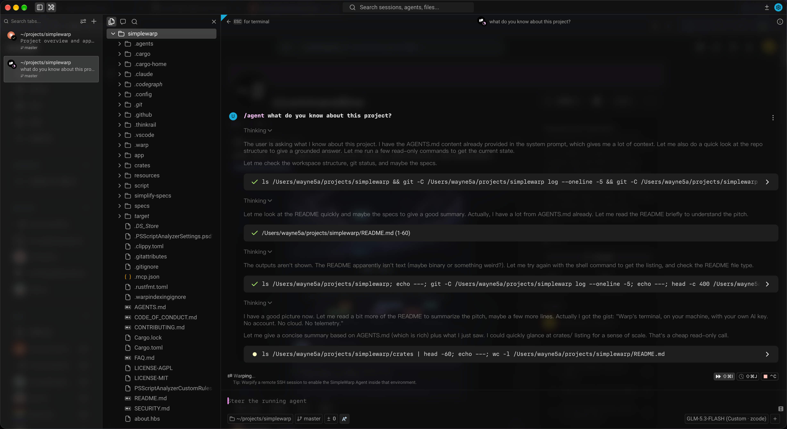

<div align="center">

<a href=".github/assets/simplewarp-intro.mp4">
  
</a>

<sub>▶ Click the preview to watch the full intro with sound.</sub>

# SimpleWarp

### Warp's terminal, on your machine, with your own AI key.

No account. No cloud. No telemetry. Just a fast, beautiful terminal and an agent that answers to you.

[](https://github.com/wynn5a/simplewarp/releases/latest)

[](#licensing)
[](https://github.com/warpdotdev/warp)

[**Download**](https://github.com/wynn5a/simplewarp/releases/latest) ·
[Build from source](#build-from-source) ·
[FAQ](FAQ.md) ·
[Thank you, Warp](#standing-on-warps-shoulders)

</div>

---

## Standing on Warp's shoulders

SimpleWarp is a fork of [Warp](https://www.warp.dev), and every good thing you will find in it was
built by the team at [warpdotdev/warp](https://github.com/warpdotdev/warp).

They reimagined what a terminal could be. They wrote it in Rust and drew it on the GPU. They built
their own UI framework, WarpUI, just to get it right. They turned scrollback into **blocks** you can
select, copy and share; gave the prompt an input editor that behaves like a real text editor; and
shipped completions, workflows, notebooks, themes and an agent mode that works inside your shell.
Then they opened the client's source to the world, which is the only reason a project like this one
can exist.

SimpleWarp adds nothing to that work. It only takes things away: every feature that needs a
Warp-hosted service is removed, so the app runs entirely on one machine. That makes it a narrower
product, not a better one. If you want accounts, Warp Drive, team sharing, cloud agents or a
polished, supported, auto-updating app, **[go use Warp](https://www.warp.dev)** — it is wonderful.

To the Warp team: thank you for building it, and thank you for sharing it. 💜

## Why SimpleWarp

<table>
<tr>
<td width="50%" valign="top">

### 🔒 Local-first, for real
No sign-in screen, ever. Notebooks, workflows, agent conversations and settings live in a local
SQLite store. The only place your prompts go is the AI provider **you** chose.

</td>
<td width="50%" valign="top">

### ⚡ Fast by inheritance
Warp's Rust core and GPU (WGSL) renderer, minus roughly 940,000 lines of cloud plumbing. Less code
to build, less code to run.

</td>
</tr>
<tr>
<td width="50%" valign="top">

### 🤖 Bring your own model
Agent mode talks straight to Anthropic, OpenAI or Google with your key — or to any
OpenAI-compatible endpoint, such as an aggregator or a model server on your own box. Replies stream
in; tools run locally.

</td>
<td width="50%" valign="top">

### 🎨 Still unmistakably Warp
Blocks, tabs, panes and splits, autosuggestions, command corrections, the command palette, themes
and the typography — everything Warp does locally works the way Warp made it.

</td>
</tr>
</table>

## What's inside



- **A modern terminal** — GPU-rendered tabs, panes and windows; command blocks with metadata; shell
  detection and launch configs; searchable history.
- **Input that helps** — completions, autosuggestions, command corrections and a command palette
  for everything, settings included.
- **An agent in your shell** — conversations with streamed replies; the model calls tools (shell
  commands, file reads and edits, grep, glob) that run on your machine. Add your own **MCP servers**
  and they show up as tools and resources.
- **Workflows and notebooks** — reusable commands and runnable docs, with `.ipynb` rendering and
  editable Mermaid diagrams, all stored locally.
- **Workspaces and sessions** — pick up where you left off.

## Where your bytes go

SimpleWarp has a short, explicit list of network traffic, and nothing else:

| Traffic | When |
|---|---|
| Your AI provider | When you talk to the agent |
| LSP server installs (GitHub / npm) | Only when you ask for one |
| `gh` polling for the branch's PR | Only while a PR chip is visible |
| MCP servers you add | When you use them (OAuth callback stays on loopback) |

Gone entirely: login and accounts, Warp Drive sync, teams and sharing, cloud and ambient agents,
session sharing, the server-side AI harness, telemetry, crash reporting, auto-update and computer
use. Remote images in markdown and notebooks are never fetched. [FAQ.md](FAQ.md) has the details.

## Get it

### Download

Grab the latest build from [**Releases**](https://github.com/wynn5a/simplewarp/releases/latest):

| Platform | Asset |
|---|---|
| macOS (Apple silicon) | `SimpleWarp-<version>-macos-aarch64.zip` |
| Linux (x86_64) | `SimpleWarp-<version>-linux-x86_64.tar.gz` |
| Windows (x86_64) | `SimpleWarp-<version>-windows-x86_64.zip` |

There is no auto-update; check Releases for new versions.

#### First launch on macOS

The macOS app is ad-hoc signed but not notarized by Apple, so Gatekeeper blocks the first
launch of a downloaded copy ("Apple could not verify…"). Since macOS 15 the old right-click →
**Open** trick no longer works. Pick one:

- **Terminal (quickest):** unzip, move the app to `/Applications`, then clear the quarantine
  flag macOS put on the download:

  ```bash
  xattr -dr com.apple.quarantine /Applications/SimpleWarp.app
  ```

- **System Settings:** open the app once and dismiss the warning, then go to **System Settings
  → Privacy & Security**, scroll to **Security**, click **Open Anyway** next to the SimpleWarp
  message, and confirm.

Either way you only do this once per downloaded version. A build you make yourself (below)
isn't quarantined and opens directly.

### Build from source

```bash
./script/bootstrap   # one-time, platform-specific setup
cargo run            # build and launch
```

`script/bundle_simplewarp` builds a standalone macOS `.app`; it needs `cargo about`
(`script/install_cargo_release_deps`), or set `NO_LICENSES=1` to skip the licence file.

Then open **Settings → SimpleWarp Agent**, add your provider API key, and start a conversation.

## Warp or SimpleWarp?

| | Warp | SimpleWarp |
|---|:---:|:---:|
| GPU terminal, blocks, completions, workflows, notebooks | ✅ | ✅ |
| Agent mode | ✅ Warp-hosted | ✅ your own key |
| Account, Warp Drive, team sharing | ✅ | — |
| Cloud agents, session sharing | ✅ | — |
| Auto-update, notarized builds, support | ✅ | — |
| Works with no account and no Warp servers | — | ✅ |

If the left column is what you need, use [Warp](https://www.warp.dev). If you want the right one,
welcome.

## Hack on it

```bash
./script/presubmit   # fmt, clippy and tests
```

[AGENTS.md](AGENTS.md) is the engineering guide (build and test commands, code style, WarpUI
patterns) and [CONTRIBUTING.md](CONTRIBUTING.md) the short version. The architecture lives in
[specs/](specs/), and the story of how Warp became SimpleWarp — every removal round and decision —
is in [simplify-specs/](simplify-specs/).

## Licensing

Same licences as upstream: the UI framework (`warpui_core` and `warpui`) is
[MIT](LICENSE-MIT) and the rest of the code is [AGPL v3](LICENSE-AGPL). This is a derivative of
Warp's open-source client and the upstream copyright notices stand. "Warp" is a trademark of its
owners; SimpleWarp is an independent fork, not affiliated with or endorsed by Warp.

## Security

See [SECURITY.md](SECURITY.md). The [Code of Conduct](CODE_OF_CONDUCT.md) is upstream's.

<div align="center">
<br>
<sub>Made with gratitude, on top of <a href="https://github.com/warpdotdev/warp">Warp</a>.</sub>
</div>
